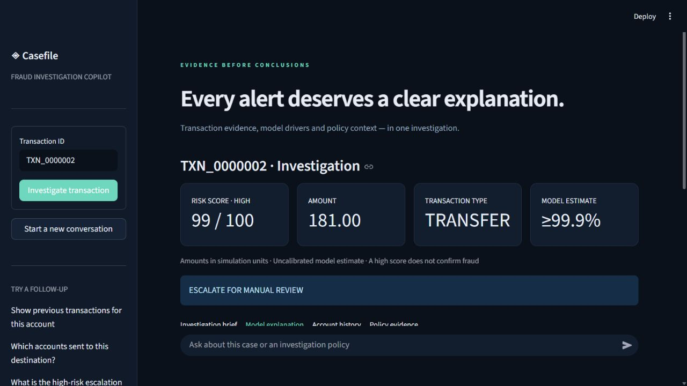
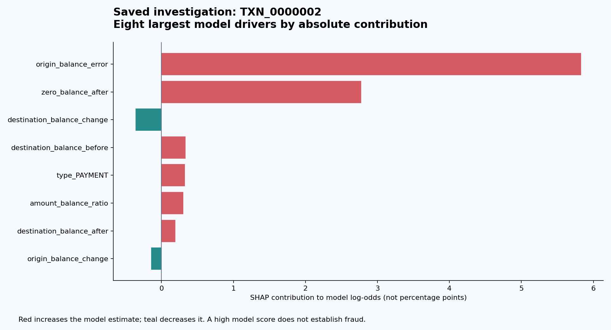

# Working Model — Fraud Investigation RAG Copilot

**An investigator dashboard that combines transaction evidence, an explainable fraud model and retrieved policy citations.** This page presents an existing local dashboard capture and saved execution artifacts so reviewers can inspect the project without installing it.

## Investigator dashboard



The example investigates `TXN_0000002`: a **TRANSFER of 181 simulation units**, with a **99/100 model score**, classified **HIGH** under the project's synthetic review policy. The recommendation is **escalation for manual review**. The model estimate is uncalibrated and does not establish fraud.

## Why did the model assign this score?



This chart is generated directly from [the saved investigation JSON](reports/sample_investigation.json). It shows the eight largest absolute SHAP contributions, rather than the complete explanation. Contributions use model log-odds, not probability percentages; individual feature effects are model behavior rather than causal findings.

## What happens when an analyst submits a transaction?

1. Fetch the transaction using fixed, parameterized database queries.
2. Retrieve earlier account history, excluding the transaction's current simulation step.
3. Calculate the XGBoost score and native TreeSHAP explanation.
4. Retrieve relevant investigation-policy passages and their source identifiers.
5. Compose a structured report and validate its evidence references.
6. Save the report for audit and allow follow-up questions in the same conversation.

For the saved example, retrieved evidence includes the synthetic `high_risk_policy.md`, section **4.2 Enhanced investigation**, which requires scores of 80 or higher to be escalated for manual review. Inspect the source IDs, excerpts and workflow in the [complete saved report](reports/sample_investigation.json).

## Recorded evaluation results

| Holdout model metric | Recorded value |
|---|---:|
| Precision | 94.74% |
| Recall | 90.00% |
| F1 | 92.31% |
| PR-AUC / average precision | 0.9087 |

These are the existing results from a **200,000-row PaySim subset**, with chronological splits and only **20 positive labels in the holdout**. They are not a real-world benchmark. See the [model metrics, splits and confusion matrix](reports/model_metrics.json).

The [recorded verification](reports/verification.json) lists 36 passing core tests and local browser checks of investigation, explanation and policy citations. These are saved verification results from the earlier build, not a claim that the complete test suite was rerun for this documentation update. Docker/PostgreSQL and live OpenAI integration remain unverified in that build.

## Run the interactive model locally

```powershell
git clone https://github.com/Sanchay20Shukla/fraud-investigation-copilot.git
cd fraud-investigation-copilot
python -m venv .venv
.venv/Scripts/python.exe -m pip install -r requirements.txt
.venv/Scripts/python.exe -m scripts.bootstrap --demo
./scripts/run-local.ps1
```

Then open `http://127.0.0.1:8510` in your browser. The generated demo requires no API key or private dataset. Its synthetic data and retrained model can produce different scores from the saved PaySim example shown above.

Try these questions in sequence:

```text
Investigate TXN_0000002
Show previous transactions for this account
Which accounts sent to this destination?
What is the high-risk escalation policy?
```

Default local mode uses lexical policy retrieval and deterministic report generation. Optional semantic retrieval and OpenAI-assisted fact selection are described in the [full README](README.md). This GitHub page displays the working-model preview; it is not a hosted interactive application.

## Explore the implementation

- [Streamlit dashboard](dashboard/app.py)
- [FastAPI service](api/main.py)
- [Investigation workflow](src/agents/graph.py)
- [API guide](docs/API.md)
- [Synthetic policy documents](documents)
- [Tests](tests)

Scope: post-transaction analyst support. Policies are educational examples, amounts have unspecified simulation currency units, and the tool does not establish identity, criminal intent or account safety.
